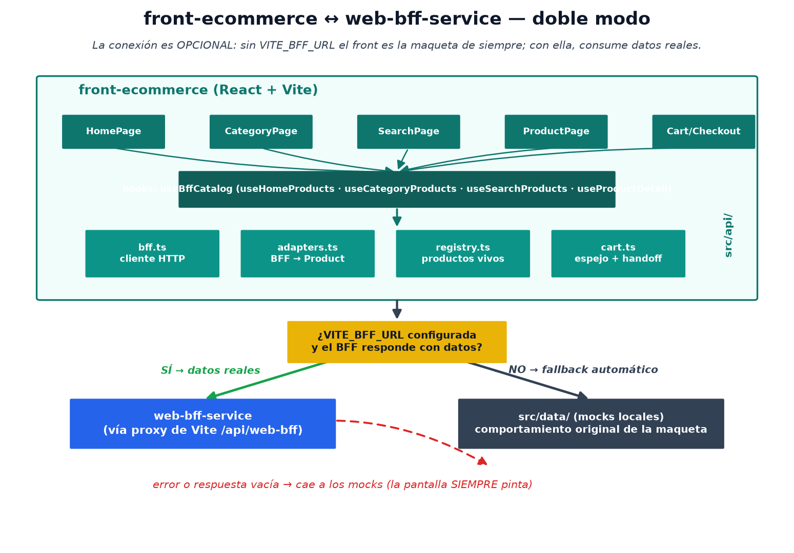
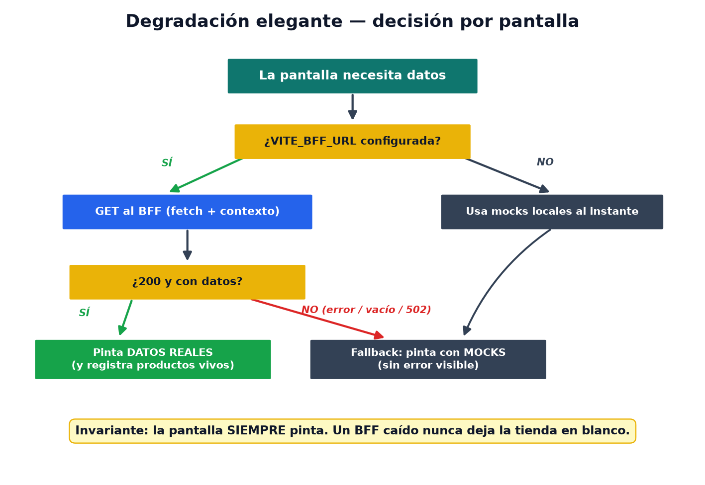
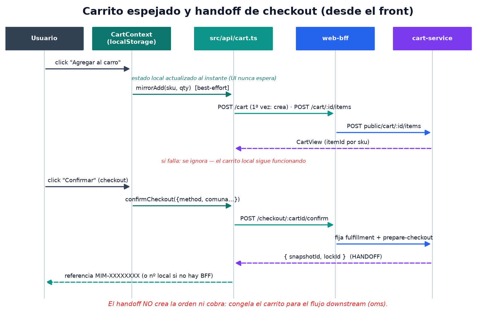
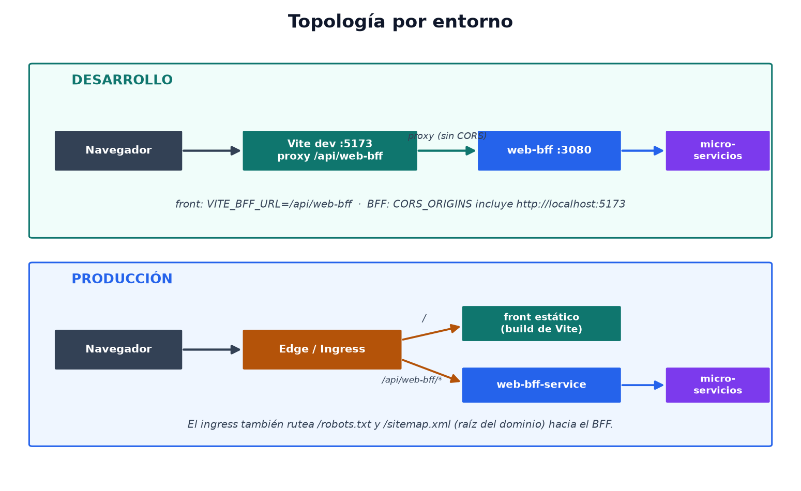
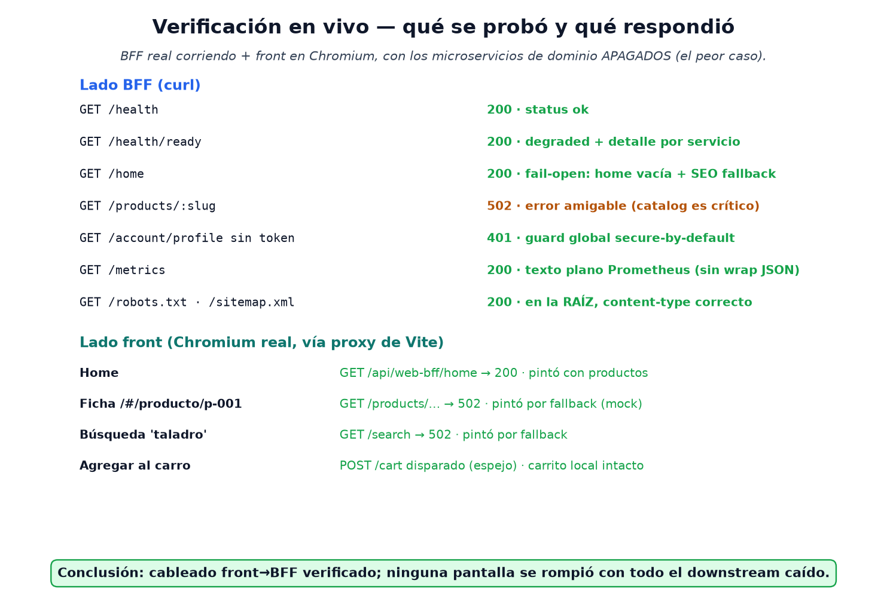

# Integración con el web-bff-service

Guía completa de cómo este front consume el **web-bff-service** (el Backend For
Frontend del ecommerce, en `Microservicios/web-bff-service`). Escrita para que
la entienda cualquiera del equipo.

**Índice**: [Idea general](#idea-general) · [Cómo activarla](#cómo-activarla) ·
[Las piezas](#las-piezas-srcapi) · [Qué pantalla usa qué](#qué-pantalla-usa-qué) ·
[Carrito y checkout](#carrito-y-checkout) · [Entornos](#entornos) ·
[Verificación](#qué-se-verificó-en-vivo) · [Troubleshooting](#troubleshooting) ·
[Límites conocidos](#límites-conocidos)

---

## Idea general

El front funciona en **dos modos** y cambia entre ellos con una sola variable:



| Modo | Configuración | Qué pasa |
| --- | --- | --- |
| **Maqueta** (default) | `VITE_BFF_URL` vacío o sin `.env` | Todo funciona con los datos de ejemplo de `src/data/` — el comportamiento original |
| **Conectado** | `VITE_BFF_URL=/api/web-bff` | Home, categoría, búsqueda y ficha cargan datos reales del BFF; el carrito se espeja; el checkout hace el handoff real |

La regla de oro del diseño es la **degradación elegante**: si el BFF no está,
falla, o responde vacío, cada pantalla vuelve sola a los datos locales.
**La tienda nunca queda en blanco.**



## Cómo activarla

```bash
cp .env.example .env
# dejar: VITE_BFF_URL=/api/web-bff
npm run dev        # el proxy de vite.config.ts manda /api/web-bff a localhost:3080
```

Requisito para ver datos reales: el web-bff-service corriendo (`Microservicios/
web-bff-service`: `npm install && npm run start:dev`) y, para datos de negocio,
sus microservicios downstream.

## Las piezas (`src/api/`)

| Archivo | Qué hace | Detalle importante |
| --- | --- | --- |
| `bff.ts` | Cliente HTTP | Genera una **sesión anónima** persistente (`x-session-id`), manda contexto (`x-sales-channel`, `x-locale`) y token si existe; errores tipados con `code` |
| `types.ts` | Tipos del BFF | Espejo de las vistas (`ProductCardView`, `CartView`, `CheckoutHandoff`…) |
| `adapters.ts` | Traducción | Convierte las vistas del BFF al tipo `Product` del front — por eso **ningún componente cambió** |
| `registry.ts` | Productos vivos | Memoria + sessionStorage; `getProduct()` de `src/data/products.ts` lo consulta **primero**, así carrito y "vistos recientemente" resuelven SKUs reales que no existen en los mocks |
| `catalog.ts` | Fetchers | `fetchHomeProducts`, `fetchCategoryProducts`, `searchProducts`, `fetchProductDetail` |
| `cart.ts` | Carrito + checkout | Espejo best-effort y `confirmCheckout()` (handoff) |
| `../hooks/useBffCatalog.ts` | Hooks por pantalla | Devuelven `{ data, live, loading }`; `live=true` solo si los datos vienen del BFF |

## Qué pantalla usa qué

| Pantalla | Hook | Endpoint del BFF | Fallback |
| --- | --- | --- | --- |
| `HomePage` | `useHomeProducts()` | `GET /home` (productos de los carruseles) | `products` de mocks |
| `CategoryPage` | `useCategoryProducts(id, slug)` | `GET /categories/:slug` | `productsByCategory()` |
| `SearchPage` | `useSearchProducts(q)` | `GET /search?q=` | filtro local |
| `ProductPage` | `useProductDetail(id)` | `GET /products/:slug` | registro → mock |
| `CartContext` | — (espejo directo) | `POST/PATCH/DELETE /cart/...` | solo local |
| `CheckoutPage` | — | `POST /checkout/:id/confirm` | confirmación local demo |

Los filtros, ordenamientos y la UI operan **igual en ambos modos**, porque el
adaptador entrega el mismo tipo `Product` de siempre (con `imageUrl` extra: si
viene, `ProductImage` muestra la foto real con fallback al tile).

## Carrito y checkout



- El carrito **local** (localStorage) manda: la UI nunca espera a la red.
- Cada add/cambio/remove se **espeja** al BFF (best-effort). La primera
  operación crea el carrito en cart-service y guarda su id.
- Al confirmar, `confirmCheckout()` fija la entrega y dispara el **handoff**
  (snapshot + lock en cart-service). El `snapshotId` se usa como número de
  referencia (`MIM-XXXXXXXX`).
- **Importante**: el handoff no crea la orden ni cobra — eso ocurre downstream.
  No mostrar "compra realizada" como si fuera una orden confirmada de verdad.

## Entornos



- **Dev**: proxy de Vite (`/api/web-bff` → `localhost:3080`), sin CORS.
- **Prod**: el edge sirve el build estático y rutea `/api/web-bff/*` al BFF
  (que además atiende `/robots.txt` y `/sitemap.xml` en la raíz del dominio).

## Qué se verificó en vivo



Con el BFF corriendo de verdad y este front en un Chromium real (y los
microservicios de dominio **apagados**, el peor caso): la home llamó al BFF y
pintó; ficha, búsqueda y carrito llamaron al BFF, recibieron 502 y **pintaron
igual** por fallback. Ninguna pantalla se rompió.

## Troubleshooting

| Síntoma | Causa probable | Solución |
| --- | --- | --- |
| Todo se ve como maqueta aunque configuré la URL | Vite no recargó el `.env` | Reiniciar `npm run dev` (las env de Vite se leen al arrancar) |
| Errores CORS en consola | Llamada directa sin proxy | Usa `VITE_BFF_URL=/api/web-bff` (proxy) o agrega tu origen a `CORS_ORIGINS` del BFF |
| Productos sin foto real | El BFF no está entregando `image` | Normal en fallback; con catalog vivo llega `imageUrl` |
| El carrito "no llega" al backend | BFF caído o cart-service caído | Es best-effort por diseño: el carrito local sigue; revisa `POST /api/web-bff/cart` en la pestaña Network |
| 401 en cuenta/pedidos | No hay token | Correcto: no existe aún proveedor de login de clientes (ver límites) |

## Límites conocidos

- **Login de clientes**: ningún microservicio del monorepo emite identidad de
  shoppers hoy; la pantalla de login sigue siendo demo local.
- **Cotizaciones, listas y favoritos**: sin backend; siguen locales.
- **Datos reales**: requieren los microservicios de dominio corriendo (catalog,
  pricing, inventory, cart…). El front y el BFF ya están listos para cuando
  estén arriba.

---

_Documentación del BFF (arquitectura, endpoints, operación):
`Microservicios/web-bff-service/docs/README.md`._
